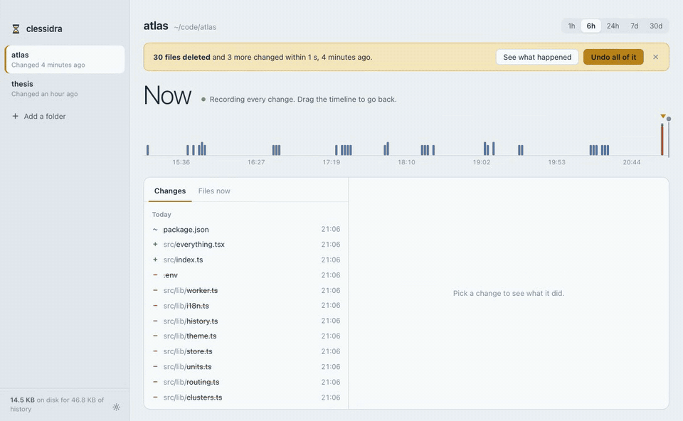

<div align="center">

# clessidra

**Undo for your whole disk.**

Every version of every file in the folders you choose, kept quietly in the background.
Drag a timeline back to any moment and put a file, a folder, or a whole burst of changes
back the way it was. The restore is recorded too, so it can be undone like anything else.

[](https://github.com/AndreaAcanfora/clessidra/actions/workflows/ci.yml)
[](Cargo.toml)
[](app/src-tauri/tauri.conf.json)
[](LICENSE)



</div>

## Why

Git remembers what you commit. Cloud sync remembers the last version. Neither saves you when a
script, a bad `rm`, an over-eager formatter or an AI agent rewrites thirty files in a second and
you notice an hour later. clessidra (Italian for *hourglass*) records every save as it happens,
so "five minutes ago" is always a place you can go back to.

## What it does

- **Records every change.** A watcher turns filesystem events into versions: created, modified,
  deleted. Nothing to commit, nothing to remember.
- **Rewinds anything.** One file, one folder or a whole watched folder, to any recorded moment.
  You see exactly what will be written and deleted before anything happens.
- **Spots bursts.** Ten or more files touched within a second of each other are grouped into a
  burst. The app notifies you and offers to undo the whole burst in one click.
- **Diffs.** Compare any past version of a file with how it is now.
- **Stays small.** Contents are zstd-compressed and content-addressed, so identical content is
  stored once. Old history is thinned out over time (see [Retention](#retention)).
- **Stays out of the way.** Build output and dependency folders (`.git/`, `node_modules/`,
  `target/`, `.venv/`, ...) are ignored by default; add your own patterns in a
  `.clessidraignore` file at the root of a watched folder, with `.gitignore` syntax.
- **Everything is local.** The history lives on your machine and never goes anywhere else.

## Install

Download the desktop app (macOS, Windows, Linux) or the command line binary from the
[latest release](https://github.com/AndreaAcanfora/clessidra/releases/latest). The builds are
not signed yet: on macOS, if the app is reported as damaged, run
`xattr -dr com.apple.quarantine /Applications/clessidra.app`; on Windows, choose *More info*
then *Run anyway*.

To build from source instead, see below.

## The desktop app

A Tauri app with a window over the history and an icon in the menu bar / system tray. It runs the
watcher for you, can start at login, and keeps recording when the window is closed (quit from the
tray menu).

```sh
cd app
pnpm install
pnpm tauri dev      # run it
pnpm tauri build    # build an installer for this platform
```

Requires Rust 1.89+, Node and pnpm, plus the [Tauri prerequisites](https://tauri.app/start/prerequisites/)
for your platform.

## The command line

The same store, from a terminal. Install it from the repository:

```sh
cargo install --path crates/clessidra-cli
```

```sh
clessidra add ~/code/atlas                       # start keeping history (takes a first snapshot)
clessidra daemon                                 # watch in the foreground (the app does this for you)

clessidra log --since 2h                         # what changed, newest first
clessidra versions src/index.ts                  # every recorded version of one file
clessidra show src/index.ts --at 14:30           # print a file as it was
clessidra diff src/index.ts --at 10m             # compare it with how it is now

clessidra restore src/ --at 14:30 --dry-run      # see what would change
clessidra restore src/ --at 14:30                # put a folder back
clessidra undo                                   # undo the most recent burst of changes
clessidra bursts                                 # recent bursts
```

Moments can be relative (`10m`, `2h`), a time today (`14:30`) or a full date (`2026-11-10 14:30`).
`list`, `remove`, `status`, `prune` and `config` manage the watched folders and the store;
`clessidra help <command>` has the details.

## Retention

| Age of a version | What is kept                         |
| ---------------- | ------------------------------------ |
| Under a day      | Everything                           |
| Up to a week     | One version per file per hour        |
| Older            | One version per file per day         |
| Over `keep_days` | Dropped                              |

If the store still exceeds `max_store_mb`, the oldest history goes first. The current version of
every file is never dropped. Pruning runs every hour while the watcher is running, or on demand
with `clessidra prune`.

```sh
clessidra config --keep-days 30 --max-store-mb 2048 --max-file-mb 32   # the defaults
```

Files larger than `max_file_mb` are not recorded.

## How it works

```
crates/clessidra-core   the engine: store, watcher, restore, diff, pruning
crates/clessidra-cli    the `clessidra` command
app/                    the desktop app (Tauri 2 + React)
```

The store is an SQLite index of versions plus a directory of zstd-compressed blobs named by
their hash. It lives in the platform's application data directory, or in `$CLESSIDRA_HOME` if set.
A restore is planned first (which files to write, which to delete), then applied; the files it
writes are recorded as new versions, which is what makes every restore undoable.

## License

[MIT](LICENSE)
